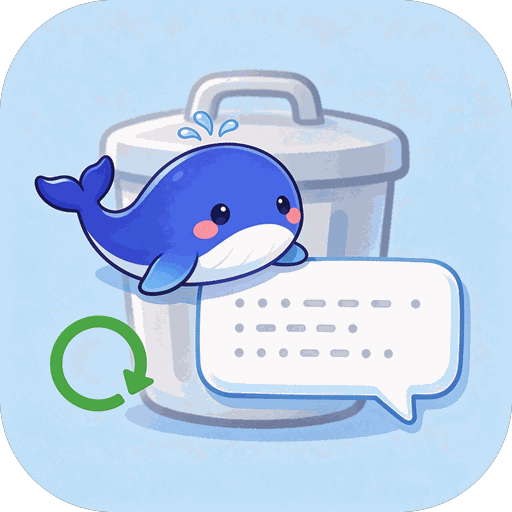
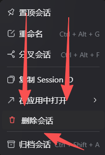
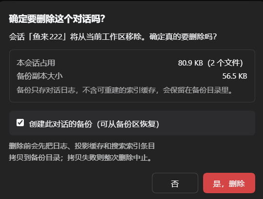

# dsh-session-revenant

Three small conveniences for the DeepSeek Harness Web UI: deleting a session,
reloading or restarting the app from the sidebar, and getting a deleted session
back from the backup directory.

## 1. Delete session

A **Delete session** row in the sidebar session menu. Clicking it opens a
confirmation dialog:

- **This session / Backup copy** — live size readout: how much space the
  session occupies (bytes and file count) and how large the backup copy would
  be. The backup row follows the checkbox: a size when checked, "no backup"
  when unchecked.
- **Yes, delete / No** — the two actions.
- **Create a backup of this conversation** — a checkbox, checked by default.
  Checked: the session is copied to the backup directory, then removed.
  Unchecked: the session is purged for real, with no copy left behind.

The dialog reads the sizes before anything is touched:

## 2. Reload page and restart app

Two controls at the sidebar foot, one above the other.

**Reload page** re-renders the interface in about a second: it drops every stale
derived view (session list, search index, projections) without touching a single
process. Most "the sidebar is out of date" cases are this one.

**Restart app** closes and relaunches the desktop application. The desktop build
keeps its own restart entry in a native `应用` menu that the Web UI cannot reach
and that only exists in development builds, so this one relaunches the
application from the inside:

- confirmation dialog first, then `POST /dsh-session-revenant/restart`;
- the Host writes a detached **Node** helper and answers immediately (a Node
  helper, not a PowerShell one: on machines where a security product blocks
  script hosts, `powershell.exe -File` exits without running anything);
- the helper parks a watchdog, stops the main process by pid, stops the Host if it
  outlived it, and starts the application again; the watchdog relaunches it if
  the helper does not survive.

Running turns are interrupted. Session history is already on disk and comes
back when the app reopens. Every step happens after the initial delay, so a
helper that dies early leaves the application running instead of half-closed.

Either control can be switched off on the plugin's own page (**Show the "Reload
page" button**, **Show the "Restart app" button**), so they only appear for people
who want them.

## 3. Backups

The plugin page lists every copy in the backup directory, newest first, with its
date and size, and a **Restore** and a **Delete** button per row:

- A copy holds the session log and a `meta.json` manifest recording where it came
  from, which workspace it belonged to, and whether it was archived or pinned.
  The projection cache and the workspace registry are both left out: the cache is
  rebuilt on the first open, and the registry is never read back on restore, so a
  backup stays close to the size of the conversation itself.
- The copy also carries `context.json`: the single line the sidebar reads a
  session title from. Without it a restored session comes back as *unnamed* until
  it is opened once, so it travels with the backup (a few hundred bytes).
- A restored conversation goes back to the state it was deleted in: same
  workspace, and archived or pinned again when it was. The restore response
  carries `flags` (what came back) and `problems` (anything the registry refused).
- Session logs are never overwritten: if the session or its log directory is
  already on disk, the restore answers `409` and changes nothing. The projection
  cache (`storages/session_projcache`) is a rebuildable derivative, so a stale
  copy there is replaced instead of blocking the restore.
- A directory without `meta.json` (an old copy, or a folder made by hand) is
  listed but marked *no manifest* and cannot be restored from the page — copy it
  back by hand instead.
- **Delete** asks first, naming the bytes it is about to free, then removes the
  backup directory for good. The conversation itself is not affected: only the
  copy goes away, which is why this is the one action here that cannot be undone.

Reload the page after a restore to see the session in the sidebar again.

### Keeping the folder small

The plugin page has one switch for this: **Delete backups older than 7 days**.

- Off (the default) — nothing is ever removed automatically. A backup lives until
  you delete it.
- On — a sweep runs every few hours and removes copies older than seven days from
  the active backup directory.

Backups in the older default folder are never swept; they age out only if you
delete them yourself, so an upgrade cannot quietly eat a copy you kept on purpose.

### Where the backups go

| Setting | Path |
| --- | --- |
| Default | `<DSH_HOME>/dsh-session-backups` |
| `DSH_SESSION_DELETE_BACKUP` in the environment | that path |
| **Backup directory** on the plugin page | that path (wins over the variable) |

Nothing is written inside the application installation directory, so updating
DeepSeek Harness never touches the backups. Set the field to an absolute path to
keep them on another drive; leave it empty for the default. Backups written by
versions before 1.1 lived in `<DSH_HOME>/../备份/session-delete`; they are still
listed, restored and deleted, and the row says *from the older folder*.

## API

- `POST /dsh-session-revenant/delete` with `{ "sessionId": "…", "backup": true }`
  (`backup` defaults to `true`).
- `POST /dsh-session-revenant/size` with `{ "sessionId": "…" }`
  → `{ sessionBytes, files, backupBytes }`.
- `POST /dsh-session-revenant/restart` with `{}` → `{ appPid, executable, helper, watchdogMs, delayMs }`.
- `GET /dsh-session-revenant/backups` → `{ root, roots, backups: [{ id, sessionId, createdAt, workspacePath, restorable, legacy, bytes, files }] }`.
- `POST /dsh-session-revenant/restore` with `{ "backup": "<id>" }`
  → `{ sessionId, restored, attachedTo, flags, problems, contextRow }`; `409`
  when the session or its log directory already exists.
- `POST /dsh-session-revenant/discard` with `{ "backup": "<id>" }`
  → `{ backupId, bytes, files }`; `404` when the directory is already gone.
- `POST /dsh-session-revenant/cleanup` with `{}` (or `{ "days": 30 }`)
  → `{ root, days, removed: [{ id, bytes }], freed }`; sweeps the active root only.
- `GET|POST /dsh-session-revenant/config` → `{ restartAction, reloadAction, backupDir, autoClean }`
  plus `backupRoot` and `defaultBackupRoot`; the preferences are stored in
  `settings.json` under the DSH home directory (`$DSH_HOME/.session_reaper`, or
  `~/.dsh/.session_reaper` when unset).

Every failure answers `{ ok: false, error, code }`. `error` is an English
developer message, `code` is a stable identifier the Client half translates, so
the interface speaks the language DSH is running in.

Client halves: one row in `sidebar.workspaces.session.menu.item`, two actions in
`sidebar.footer.action` (reload above restart), and one settings card in
`plugins.bundle.config` (the backup list sits at the top of that card).

See `docs/DETAIL.md` for behaviour, backup location and limitations.

## Install

In DeepSeek Harness: **Plugins** → **Add plugin** → enter `dsh-session-revenant`.

While developing locally, point `install_bundle` at this directory instead and
the profile keeps a live link to the sources.

## Licence

MIT. Built for DeepSeek Harness; the sidebar menu, footer and plugin page are
ordinary DSH client slots, so nothing in the application itself is patched.
